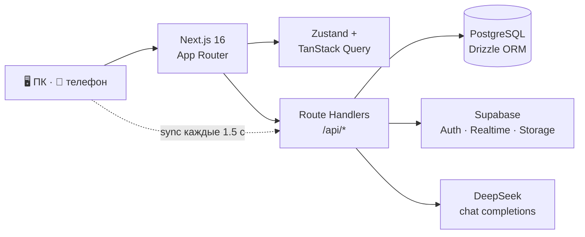

<div align="center">

# 🐉 D&D Master Hub

### Рабочий стол Мастера D&D 5e — «Хроника и бой»

**Листы персонажей · бой · карта · песенник · дневник кампании — синхронно у всей партии.**

[](https://solid-octo-robot-blue.vercel.app)
[](#-стек)
[](#-стек)
[](#-стек)
[](#-база-и-доступ)
[](#-ии-мастер)

[Возможности](#-возможности) · [Разделы](#-разделы) · [Быстрый старт](#-быстрый-старт) · [Переменные](#-переменные-окружения) · [Деплой](#-деплой)

</div>

> **Один экран вместо шести вкладок.** Мастер ведёт бой с ноутбука, игроки смотрят карту и слушают
> музыку с телефона — с той же секунды, с тем же порядком ходов и тем же броском кубика.
> Тёмное золото, эффект «жидкого стекла» и пергамент — чтобы стол выглядел как стол, а не как таблица.

---

## ✨ Возможности

| | |
|---|---|
| ⚔️ **Живой бой** | Инициатива, раунды, временные хиты, спасброски от смерти, бестиарий, сопротивление и уязвимость к типам урона, отмена последних действий |
| 🗺️ **Карта 2.0** | Несколько сцен, фон, квадратная и гекс-сетка, перетаскивание фишек, туман войны, стены и двери, рисование и зоны заклинаний, указка |
| 🎲 **Броски в один клик** | Навык или спасбросок прямо из листа; помеха от состояний считается сама; тайные броски Мастера и проверки по запросу — с закрытым результатом |
| 🎵 **Песенник** | Настоящие CC0-треки прямо из GitHub: очередь, повтор, пауза и общая громкость, синхронно у всех |
| 🧙 **Листы по правилам** | Модификаторы, 18 навыков, владение и экспертиза, пассивная внимательность, ячейки заклинаний full/half/third/pact, нагрузка, КД |
| 💰 **Экономика** | Лавки, общий сундук партии, передача предметов и золота без потерь, генератор добычи |
| 🌍 **Мир кампании** | Квесты, NPC с тайнами и связями, карта мира с метками, календарь с обратным отсчётом, хроника |
| 💬 **Стол общения** | Чат с `/roll 2d6+3`, шёпот, тайные записки, реакции, напоминания в Telegram |
| 🤖 **ИИ-Мастер** | NPC, предыстория, судья правил, события — только через DeepSeek, ключ живёт на сервере |
| 🔐 **Аккаунты и права** | Email + пароль, HttpOnly-сессия, роли DM и игрока, DM-only заметки, RLS в Supabase |
| 📱 **PWA** | Устанавливается на телефон, тёмная и светлая тема, акцентный цвет |

## 🗺 Разделы

| Маршрут | Раздел | Для кого |
| --- | --- | --- |
| `/` | Обзор кампании: партия, бой, журнал | все |
| `/characters` | Листы персонажей и NPC | все |
| `/initiative` | Трекер инициативы и бестиарий | все |
| `/map` | Тактическая карта | все |
| `/dice` | Кубики и общий лог бросков | все |
| `/chat` | Чат стола, шёпот, тайные записки | все |
| `/world` | Квесты, NPC, карта мира, календарь | все |
| `/economy` | Лавки, сундук партии, добыча | все |
| `/music` | **Песенник из GitHub** | все (управляет Мастер) |
| `/scene` | Сцена: картинки, эффекты, погода | Мастер |
| `/screen` | Полноэкранный вид для телевизора | все |
| `/codex` · `/journal` | Кодекс правил и журнал сессий | все |
| `/ai` | ИИ-Мастер | все |
| `/print/[id]` | Печатный лист персонажа | все |

## ⚔️ Правила, а не картинка

- модификаторы `⌊(score − 10) / 2⌋`, бонус владения по уровню, экспертиза, спасброски;
- 12 классов с костями хитов и таблицами ячеек заклинаний, включая пакт-магию колдуна;
- 18 состояний с механикой и автоподсказкой помех; при 0 HP — «Без сознания» и спасброски от смерти;
- парсер `2d6+3`, `4d6kh3`, `2d20kl1`, преимущество и помеха, криптографический RNG;
- нагрузка `СИЛ × 15 / × 30 / × 45`, КД от надетого доспеха и щита, XP и повышение уровня;
- концентрация после урона: СЛ `max(10, ½ урона)`, «Боевой заклинатель» даёт преимущество.

## 🧱 Стек

| Слой | Технологии |
| --- | --- |
| Фронтенд | **Next.js 16** (App Router) · React 19 · TypeScript · Tailwind CSS 4 |
| UI | Framer Motion · lucide-react · Radix UI · «liquid glass» и пергамент |
| Состояние | **Zustand** · **TanStack Query** (оптимистичные обновления с откатом) |
| Формы | React Hook Form + **Zod** — одни схемы на клиенте и сервере |
| Бэкенд | Route Handlers · **Drizzle ORM** · PostgreSQL |
| Сервисы | **Supabase** (Auth, Realtime, Storage) · **DeepSeek** API · Resend · Telegram Bot API |

## 🏗 Архитектура



**Синхронизация.** Мастер меняет состояние → сервер пишет снимок в PostgreSQL → остальные
получают его через Supabase Realtime, а без него — интервальный `/api/sync`, который загружает
данные только при реальных изменениях. Музыка хранит `startedAt`, `offset` и длительности треков,
поэтому позиция песни вычисляется на устройстве и совпадает у всех.

## 🚀 Быстрый старт

```bash
git clone https://github.com/vlad29721-jpg/solid-octo-robot.git
cd solid-octo-robot
npm install
cp .env.local.example .env.local     # заполните ключи
npm run dev                          # http://localhost:3000
```

База самовосстанавливается: при первом запросе создаются таблицы и демо-данные
(2 кампании, персонажи, заметки, бой и журнал бросков).

**Демо-стол:** Мастер **Эларион Вещий**, игроки **Лиана** и **Торин**.
Коды приглашений: `GRIMHOLM-7K` и `DRAGON-ASH-42`.

## 🔑 Переменные окружения

| Переменная | Обязательна | Назначение |
| --- | --- | --- |
| `DATABASE_URL` | ✅ | PostgreSQL. Для Vercel — **Transaction pooler** из Supabase |
| `NEXT_PUBLIC_SUPABASE_URL` | ➖ | Supabase Auth, Realtime, Storage |
| `NEXT_PUBLIC_SUPABASE_ANON_KEY` | ➖ | Публичный ключ; данные закрывает RLS |
| `DEEPSEEK_API_KEY` | ➖ | ИИ-Мастер. **Только сервер**, без `NEXT_PUBLIC_` |
| `NEXT_PUBLIC_SITE_URL` | ➖ | Абсолютные ссылки в письмах |
| `TELEGRAM_BOT_TOKEN` | ➖ | Напоминания и тайные записки в Telegram |
| `RESEND_API_KEY` · `EMAIL_FROM` | ➖ | Письма: восстановление пароля |
| `CRON_SECRET` | ➖ | Защита `/api/cron/reminders` |

> 🔒 Файл `.env.local` в репозиторий не попадает. Секреты добавляйте только в панели Vercel.

## 🗄 База и доступ

1. Supabase → **SQL Editor** → выполните `supabase/00_schema.sql` (таблицы, RLS, Realtime, Storage).
2. Затем `supabase/01_demo.sql` — демонстрационные кампании и персонажи.
3. Включите Email Auth и Realtime для `dice_rolls`, `encounters`, `characters`, `sessions`.

| Роль | Что видит |
| --- | --- |
| Игрок | своих персонажей, открытые заметки, броски и бой своей кампании |
| Мастер | всё в кампаниях, где он `dm_id`, включая заметки «только для DM» |

Те же правила продублированы на сервере (`src/lib/server/access.ts`): демо работает без Supabase,
а production остаётся закрытым.

## ☁️ Деплой

[](https://vercel.com/new/clone?repository-url=https://github.com/vlad29721-jpg/solid-octo-robot)

1. **Vercel → Add New Project → Import** репозитория (Next.js определится сам).
2. Добавьте `DATABASE_URL` и, при желании, остальные ключи для **Production**.
3. Нажмите **Deploy** и проверьте `/api/health` — должно вернуться `{"ok":true}`.

После изменения переменных нужен **Redeploy**: старые сборки не подхватывают новые значения.

## 🧪 Проверка

```bash
npx next typegen
npm exec tsc -- --noEmit --pretty false
npm run build
curl -s http://localhost:3000/api/health
```

## 📡 Основные API

<details>
<summary><b>Показать маршруты</b></summary>

| Маршрут | Назначение |
| --- | --- |
| `GET /api/hub` · `GET /api/sync` | Снимок кампании с учётом прав |
| `POST /api/campaigns` · `/join` | Создание кампании и вход по коду |
| `/api/characters/[id]` | Лист, инвентарь, отдых, повышение уровня, спасброски от смерти |
| `/api/encounters/[id]` | Бой: атака, HP, XP, отмена действий |
| `/api/rolls/check` · `/rolls/concentration` | Проверки (в т.ч. тайные) и концентрация |
| `/api/boards/[campaignId]` | Карта, сцена, освещение, указка |
| `/api/music/github` | Каталог CC0-треков из GitHub |
| `/api/messages` · `/api/polls/vote` | Чат, шёпот, голосования за дату |
| `/api/chest` · `/api/shops` | Сундук партии и лавки |
| `/api/auth/*` | Регистрация, вход, сброс пароля, смена email |
| `/api/deepseek` | Серверный прокси к DeepSeek |
| `/api/health` | Состояние БД и доступных сервисов |

</details>

## 🗺 Roadmap

- [x] Листы персонажей и трекер инициативы
- [x] Карта с туманом войны и освещением
- [x] Чат, сцена, ТВ-экран, мир и экономика
- [x] Песенник с реальными треками из GitHub
- [x] Аккаунты, роли и тайные заметки
- [ ] Шаблоны заклинаний с уроном по площади
- [ ] Экспорт кампании в PDF одной книгой
- [ ] Голосовой чат прямо в столе

## 🎼 Музыка

Песенник использует только **CC0 / общественное достояние**: файлы лежат на GitHub и загружаются
напрямую, сайт их не хранит.

- [AlienOmen/ufo-cut-assets](https://github.com/AlienOmen/ufo-cut-assets) — CC0-1.0
- [jupixels/game-sounds](https://github.com/jupixels/game-sounds) — музыка CC0 (Cethiel, Umplix)
- [effacestudios/Royalty-Free-Music-Pack](https://github.com/effacestudios/Royalty-Free-Music-Pack) — CC0-1.0

Свой трек добавляется в `public/music/playlist.json` (нужны `url` и `duration`).

---

<div align="center">

**[D&D Master Hub](https://solid-octo-robot-blue.vercel.app)** · сделано для ночей, когда кубики уже не помещаются на столе

<sub>D&D 5e — товарный знак Wizards of the Coast. Проект некоммерческий и не связан с WotC.</sub>

</div>
