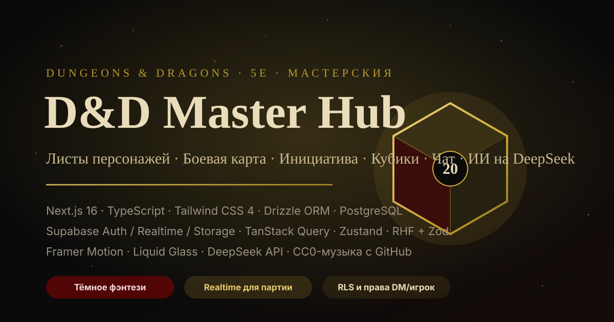

<p align="center">
  
</p>

<h1 align="center">D&D Master Hub</h1>
<p align="center"><b>Премиальный рабочий стол Мастера Dungeons &amp; Dragons 5e</b><br>
Листы персонажей · боевая карта с туманом войны · трекер инициативы · кубики в реальном времени · чат · мир и квесты · торговля · ИИ-студия на DeepSeek</p>

<p align="center">
  
  
  
  
  
  
  
</p>

---

## ✨ Живое демо

| | |
|---|---|
| 🌐 **Сайт** | https://solid-octo-robot-blue.vercel.app |
| 🗺 **Демо-кампании** | `GRIMHOLM-7K` · `DRAGON-ASH-42` |
| 🎭 **Демо-профили** | Эларион Вещий (DM) · Лиана · Торин |
| 🧬 **Локальный режим** | работает без внешних сервисов: БД создаётся и засевается автоматически |

> 💡 **Тайный план Мастера** — заметка «Секретный план Мастера» в журнале видна только роли DM. Переключитесь на игрока в диалоге аккаунта и убедитесь, что её не видно.

---

## 🗺 Возможности

### 🧙 Лист персонажа
- Автомодульный расчёт: `⌊(score − 10) / 2⌋`, бонус владения по уровню, экспертиза ×2
- 12 классов: кость хитов, спасброски, подклассы с способностями по уровням, ячейки заклинаний (full/half/third/pact)
- 18 состояний (отравлен, испуган, парализован…) с механическими эффектами и поправкой к пассивной внимательности
- Инвентарь с весом, лимит `СИЛ × 15`, вариант «нагрузка», расчёт КД от экипировки
- Монеты (ПМ/ЗМ/ЭМ/СМ/ММ), ресурсы класса, вдохновение, черты, спутники
- **Одно действие**: атака оружием → попадание по КД цели → автоурон с критом и типом урона
- Короткий/долгий отдых, повышение уровня, спасброски от смерти, печать/PDF
- Пошаговый мастер создания героя: раса → класс → предыстория → покупка очков → навыки

### ⚔️ Трекер инициативы и бой
- Сортировка по инициативе и ЛОВ, раунды, текущий ход, журнал событий
- Монстры и герои, быстрое изменение HP с типом урона, лечение
- **Бестиарий 17 монстров** с готовыми атаками и авто-инициативой
- Сложность боя по XP (DMG): пороги «пустяк → смертельный»
- Эффекты с длительностью в раундах, **отмена до 15 действий назад**
- Опыт за бой и шкала до следующего уровня
- Сопротивления/уязвимости/иммунитеты монстров: урон считается сам

### 🗺 Боевая карта
- Своя картинка или сетка, фишки с размерами и цветами
- **Туман войны кистью** (1×1 / 3×3 / 5×5), игрок видит только открытое
- **Динамическое освещение**: факелы, тёмное зрение, стены закрывают линию обзора
- Стены и двери (Мастер открывает щелчком), зоны заклинаний: круг / конус / линия
- Линейка в футах, рисование, стрелки, помётки-тексты, **указка** двойным кликом
- Библиотека нескольких карт кампании, ТВ-экран для проектора

### 🎲 Кубики
- Парсер `2d6+3`, `4d6kh3`, `2d20kh1` (преимущество), `2d20kl1` (помеха)
- Криптографический RNG, до 100 кубикей и 1000 граней
- Анимация броска, 3D-кубик с материалом и цветом каждого игрока
- Общий журнал в реальном времени; тайные броски Мастера скрыты от игроков
- Броски навыков и спасброски из листа в один клик, с учётом состояний и вдохновения
- Запрос проверки от Мастера — открытый или **тайный** (игрок не узнает результат)

### 🎭 Ширма Мастера и атмосфера
- Показ картинок и текстов всем игрокам на весь экран
- Групповой спасбросок с таблицей результатов
- 8 звуковых эффектов, погода (дождь/гроза/снег/туман), время суток
- **Музыка для всех**: 18 CC0-треков с GitHub, очередь, повтор, общая громкость
- Камера при 0 HP: красное свечение и тряска экрана

### 🌍 Мир и организация
- Квесты (активны/выполнены/провалены, скрытые), NPC с портретами, связями и тайнами
- Карта мира с метками, локациями и статусом «посещено»
- Календарь сессии с обратным отсчётом, **голосование за дату**, отметки посещений
- Авто-хроника кампании из боёв, повышений уровня и событий

### 💰 Экономика
- Лавки Мастера: покупка/продажа за золото персонажа, склады, цены
- Общий сундук партии: вклады, снятие, **деление золота поровну** одной кнопкой
- Генератор добычи по таблицам DMG (ПО 0–4 … 17+), магические предметы с зарядами и настройкой (макс. 3)

### 💬 Социальное
- Чат кампании, `/roll 2d6+3` прямо в сообщении, шёпот, **тайные записки Мастера**
- Реакции 🔥 💀 😱 😂 👍 🎲, уведомления и непрочитанные
- Telegram-уведомления: тайная записка, напоминание «игра через час»

### 🤖 ИИ-студия (только DeepSeek)
- Генератор NPC, помощник по предыстории, судья правил (`deepseek-reasoner`), случайные события
- Контекст кампании подставляется автоматически, история диалога, сохранение в журнал
- Серверный прокси `/api/deepseek`: ключ не попадает в браузер; обработка 401/402/429/5xx

### 🔐 Платформа
- Личные аккаунты (email + пароль, scrypt, HttpOnly-сессия) **и** Supabase Auth
- RLS-правила: игрок видит свой лист и открытые заметки, DM — всё
- Управление участниками: исключить, передать права Мастера, новый invite-код
- Экспорт/импорт кампании в JSON, офлайн-кэш листа, PWA на телефон
- Светлая/тёмная тема, акцентный цвет, кастомные кубики
- Оптимистичные обновления TanStack Query с rollback, скелетоны, пустые состояния

---

## 🛠 Стек

`Next.js 16 (App Router)` · `TypeScript` · `Tailwind CSS 4` · `Drizzle ORM` · `PostgreSQL` · `Supabase (Auth / Realtime / Storage)` · `Zustand` · `TanStack Query` · `React Hook Form + Zod` · `Framer Motion` · `lucide-react` · `DeepSeek API` · `CC0-музыка с GitHub`

---

## 🚀 Быстрый старт

```bash
npm install
cp .env.local.example .env.local   # заполните ключи
npx drizzle-kit push               # создать таблицы (или запустите приложение — оно само)
npm run dev
```

Приложение **самовосстанавливает базу**: `src/db/seed.ts` в транзакции с advisory lock создаёт таблицы (`CREATE TABLE IF NOT EXISTS`) и один раз засевает демо-данные. `/api/health` тоже инициализирует БД.

---

## ☁️ Деплой на Vercel + Supabase

1. **GitHub** — загрузите проект в репозиторий.
2. **Supabase** — https://supabase.com/dashboard → New project → скопируйте строку **Transaction pooler** (порт `6543`) из окна **Connect** и ключ **anon** из **Settings → API**.
3. **Vercel** — https://vercel.com/new → Import GitHub-репозиторий → **Environment Variables**:

| Переменная | Обязательна | Назначение |
|---|---|---|
| `DATABASE_URL` | ✅ | PostgreSQL (Supabase или локальная) |
| `DEEPSEEK_API_KEY` | для ИИ | https://platform.deepseek.com/api_keys |
| `NEXT_PUBLIC_SUPABASE_URL` | для Auth/Realtime | Project URL |
| `NEXT_PUBLIC_SUPABASE_ANON_KEY` | для Auth/Realtime | anon public key |
| `TELEGRAM_BOT_TOKEN` | для уведомлений | бот у @BotFather |
| `RESEND_API_KEY` + `EMAIL_FROM` | для писем | https://resend.com |
| `CRON_SECRET` | для автонапоминаний | любая строка |
| `NEXT_PUBLIC_SITE_URL` | для ссылок в письмах | адрес сайта |

4. **Deploy** → откройте `/api/health` → должно быть `"ok":true`.

> SQL для Supabase: `supabase/00_schema.sql` (таблицы, RLS, Realtime publication, bucket `avatars`, RPC приглашений) и `supabase/01_demo.sql` (демо-данные). Без Supabase включается локальный демо-режим с polling-синхронизацией.

---

## 🗄 База и RLS

| Таблица | Содержит |
|---|---|
| `profiles` | роль `dm`/`player`, аватар, telegram, предпочтения |
| `campaigns` | Мастер, invite-код, статус |
| `campaign_members` | участники |
| `characters` | stats/inventory/spells/conditions JSONB |
| `sessions` | заметки, `is_dm_only` |
| `encounters` | state боя + история 15 отмен |
| `dice_rolls` | лог бросков, `hidden` для тайных |
| `boards` | карта/туман/стены, сцена (музыка, погода, проверки), мир (квесты, NPC, магазины, сундук) |
| `messages` | чат, шёпот, тайные записки, `/roll` |
| `assets` | изображения кампании (base64) |
| `auth_sessions`, `password_resets` | локальные аккаунты |

**Правила доступа:** игрок видит только свои `characters` и `sessions` без `is_dm_only`; DM видит всё в своих кампаниях; броски и бой — всем участникам; Storage `avatars/{user_id}` — запись только владельцу. Те же правила продублированы на сервере в `src/lib/server/access.ts`.

---

## 🎵 Музыка и лицензии

Песенник берёт **CC0-треки напрямую с GitHub** (файлы не хранятся у нас):

- https://github.com/AlienOmen/ufo-cut-assets (CC0-1.0)
- https://github.com/jupixels/game-sounds (музыка CC0)
- https://github.com/effacestudios/Royalty-Free-Music-Pack (CC0-1.0)

Каталог редактируется в `public/music/playlist.json` — добавляйте свои CC0-файлы прямо в репозиторий.

---

## 📡 API

`GET /api/health` · `GET /api/hub` · `POST /api/campaigns` · `/api/campaigns/join` · `POST /api/characters` · `PATCH|DELETE /api/characters/[id]` · `/api/characters/[id]/{inventory,level-up,rest,death-save}` · `/api/characters/transfer` · `POST /api/sessions` · `POST /api/encounters` · `PATCH /api/encounters/[id]` · `/api/encounters/[id]/{hp,attack,undo,award-xp}` · `POST /api/dice-rolls` · `POST /api/rolls/check` · `POST /api/rolls/concentration` · `PATCH /api/boards/[campaignId]` · `/api/boards/[campaignId]/{token,ping,draw,group-save}` · `POST /api/messages` · `/api/messages/[id]/react` · `POST /api/shops` · `POST /api/chest` · `POST /api/polls/vote` · `POST /api/assets` · `POST /api/deepseek` · `POST /api/auth/{register,login,logout,forgot,reset,account}` · `POST /api/telegram/{test,remind}` · `GET /api/cron/reminders` · `GET /api/campaigns/[id]/{export,members}` · `POST /api/campaigns/import`

---

## 🧪 Проверка

```bash
npx next typegen
npm exec tsc -- --noEmit --pretty false
npm run build
npx drizzle-kit push
```

---

<p align="center"><i>Roll for initiative. 🎲</i></p>
